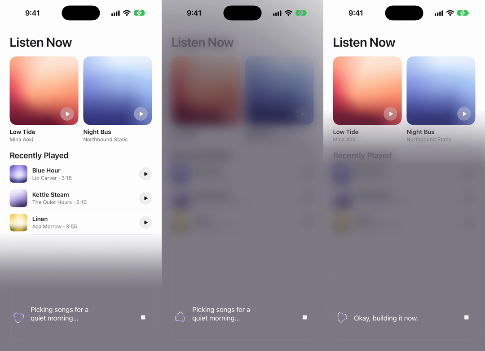

# Fog Voice

A voice assistant for iOS that answers in a layer of fog instead of taking over the screen. The page stays visible behind the fog, and the assistant is a ring of dots that turns into a different flower while it listens, searches and checks.

Built in SwiftUI. The voice is simulated, and the songs and artists are made up.

## Three flows

- Bottom fog: the fog covers only the lower part of the screen and holds the answer cards.
- Full fog: the same question, with the whole page pushed back.
- Make a playlist: starts as bottom fog, then the fog grows with the conversation.

## How it works

`FogReveal.swift` is a view modifier that lays a material and a dark tint over the content, masked by an elliptical radial gradient that grows from the agent button. With a `band` set, the fog only fills a strip at the bottom with a 140 pt soft top edge. `DotAgent.swift` draws the agent, and the result cards in `AssistantViews.swift` use `.scrollTargetBehavior(.viewAligned)` with a `scrollTransition` that scales cards down by up to 8% as they leave the view.

## Run

Open `FogReveal.xcodeproj` in Xcode and run on an iPhone simulator (iOS 18 or later).

## Credits

The fog reveal, its timing and the dot agent are adapted from [Organic UI](https://github.com/michellesijiama/atomicmotion-ui/tree/main/components/ai/organic-ui) in atomicmotion-ui (MIT).
